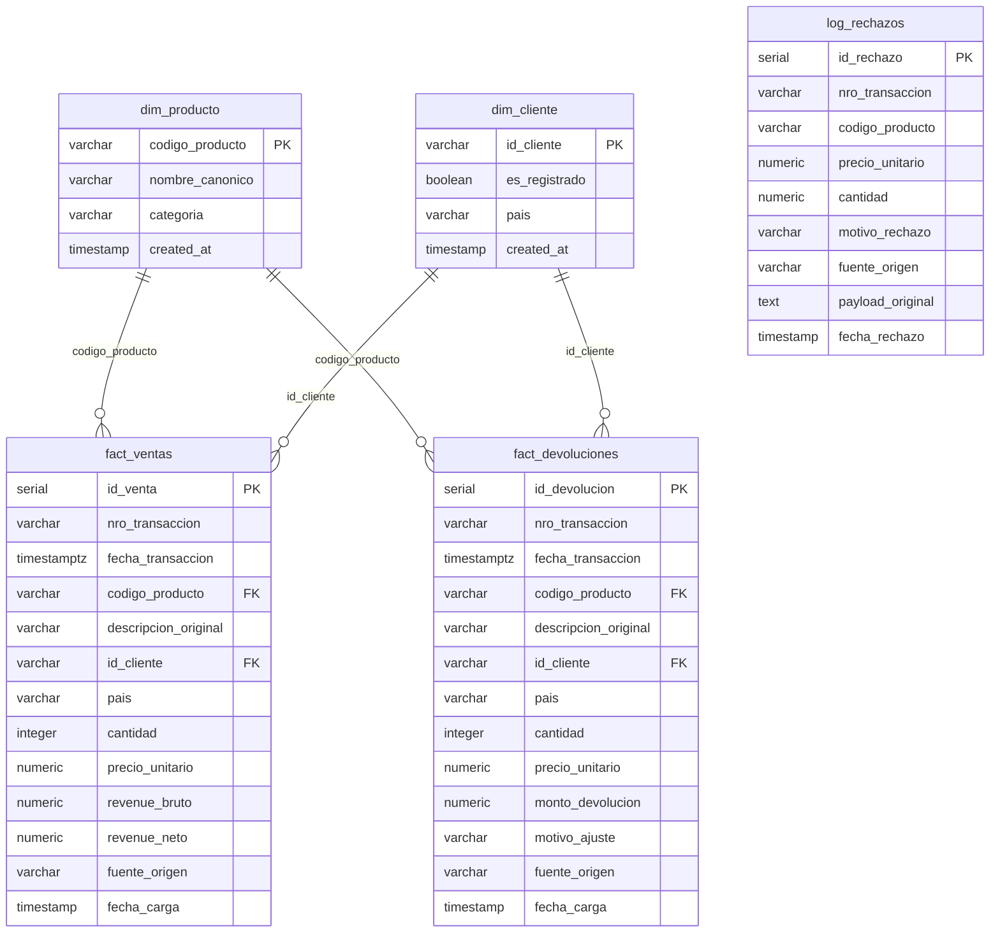

# ETL Pipeline with Apache Airflow and Data Warehouse - DataMart S.A.S.

End-to-end data engineering solution for ingestion, cleansing, enrichment, and analytical loading of e-commerce transactions into PostgreSQL, orchestrated with Apache Airflow and Docker.

---

## 🚀 System Architecture

- **Apache Airflow 2.8.1 (LocalExecutor):** Orchestrates the daily pipeline stages: extraction, transformation, enrichment, idempotent loading, and quality validation.
- **PostgreSQL Airflow Metadata (Port 5432):** Dedicated internal database for Airflow scheduler and webserver state.
- **PostgreSQL Analytical Data Warehouse (Port 5433):** Star schema analytical repository (`datamart_dw`) initialized automatically on startup (`sql/init_dw.sql`).
- **FastAPI Product Catalog API (Port 8000):** Lightweight REST microservice serving the legacy product catalog (`/products` and `/products/{code}`).

---

## 📊 Data Warehouse Model (Star Schema)



---

## ⚡ Quick Start Guide (< 2 Minutes)

### Option A: One-Click Automated Demo (Recommended for Evaluation)
- **On Windows:** Double-click `demo.bat` (or run `.\demo.bat` in terminal).
- **On Linux/macOS:** Run `bash demo.sh`.

*This script sets up `.env`, boots Docker containers, triggers the Airflow DAG, and displays query results automatically in ~25 seconds.*

### Option B: Manual Setup
```bash
# 1. Clone repository
git clone https://github.com/Keinerdmb/datamart-airflow-etl.git
cd datamart-airflow-etl

# 2. Copy environment configuration
cp .env.example .env

# 3. Start containers
docker compose up -d

# 4. Trigger the DAG
docker exec -i datamart-airflow-webserver airflow dags trigger datamart_ecommerce_pipeline
```

---

## 🌐 Endpoints & Credentials

| Service | Access URL | Credentials | Purpose |
| :--- | :--- | :--- | :--- |
| **Airflow UI** | [http://localhost:8080](http://localhost:8080) | `admin` / `admin` | DAG orchestration and monitoring |
| **Data Warehouse (PostgreSQL)** | `localhost:5433` | User: `dw_admin` / Pass: `dw_secret_pass` / DB: `datamart_dw` | Analytical database |
| **Products API (FastAPI)** | [http://localhost:8000/docs](http://localhost:8000/docs) | None (Public) | Interactive Swagger API docs |

---

## 📈 Analytical Business Findings & Product Recommendation

Direct answers to business questions backed by real numbers from the loaded Data Warehouse:

1. **Monthly Net Revenue Evolution:**
   - **2010-12:** $451,485.72 USD net revenue across 902 orders.
   - **2019-12:** $1,977,557.27 USD net revenue across 813 orders.
2. **Category Performance & Return Rate:**
   - **Hogar (Home):** Highest gross revenue ($1,606,190.17 USD) with a healthy return rate of **4.79%**.
   - **Papelería (Stationery):** Generated $1,151,341.27 USD gross revenue with a critical return rate of **43.70%** ($503,145.71 USD in returns).
3. **Customer Segment Behavior (Registered vs Guest):**
   - **Registered Customers:** 1,653 orders, total revenue $2,830,900 USD, average order ticket of **$1,712.58 USD**.
   - **Guest Checkouts (`GUEST`):** 62 orders, total revenue $142,268 USD, average order ticket of **$2,294.65 USD** (+34% higher ticket than registered accounts).
4. **Concrete Data-Backed Product Recommendation:**
   - **Action item:** Immediate operational review on product code **`23843` (PAPER CRAFT LITTLE BIRDIE)**. This single SKU had **80,995 units sold and 80,995 units returned (100% cancellation/return rate)**, creating a net revenue adjustment of **$501,359.05 USD**.
   - **Root cause hypothesis:** Likely a bulk commercial trial or defective batch wholesale order. We recommend investigating supplier quality controls and adjusting bulk ordering terms for wholesale accounts.

---

## 📁 Repository Structure

```text
├── .env.example              # Environment variables template
├── .gitignore                # Git exclusion rules (credentials and temporary files)
├── docker-compose.yml        # Multi-container orchestration definition
├── demo.bat                  # One-click demo script for Windows
├── demo.sh                   # One-click demo script for Linux/macOS
├── api/
│   ├── main.py               # FastAPI microservice (legacy product catalog)
│   └── Dockerfile            # Container image build instructions
├── dags/
│   └── datamart_etl_dag.py   # Airflow DAG definition with explicit task dependencies
├── scripts/
│   └── etl_process.py        # Core ETL logic (extraction, cleaning, business rules, loading)
├── sql/
│   ├── init_dw.sql           # Data Warehouse DDL schema definition
│   └── queries_negocio.sql   # SQL analytical queries answering business questions
├── data/
│   ├── raw/                  # Raw input datasets (data.csv and Sales Transaction)
│   └── processed/            # Staging directory for intermediate cleaned datasets
└── docs/
    ├── DECISIONES.md         # Technical decisions, ambiguity resolution, and idempotency
    └── modelo_datos.md       # Data model entity-relationship diagram and documentation
```
