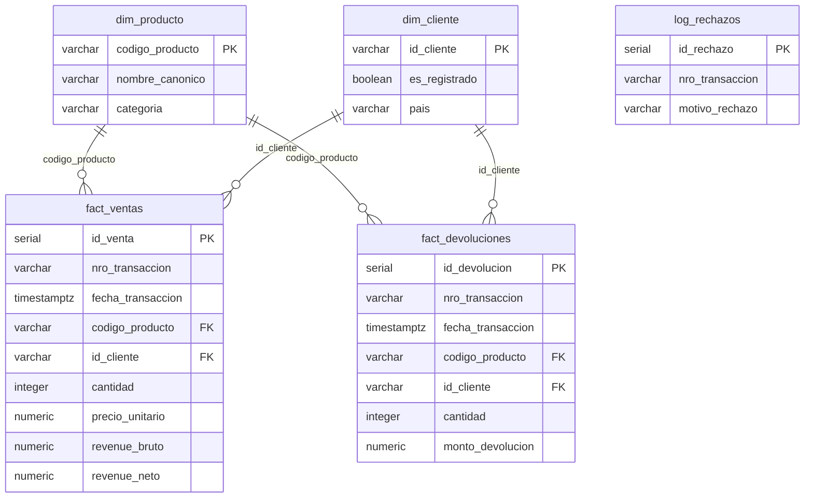

# DataMart S.A.S. - Data Pipeline & Warehouse

A simple data pipeline built with **Docker**, **Apache Airflow**, and **PostgreSQL**. It reads daily sales and transaction history files, cleans the data, and stores it in an analytical database for reporting.

---

## 🚀 How It Works (Simple Overview)

The project runs 4 services in Docker:
1. **Airflow (Port 8080):** Controls the schedule and runs the data tasks in order.
2. **PostgreSQL DW (Port 5433):** The analytical database with our cleaned tables.
3. **Product Catalog API (Port 8000):** A small FastAPI service providing product details.
4. **Airflow Database (Port 5432):** Internal database used by Airflow.

---

## 📊 Database Design (Star Schema)

The database organizes data into 5 clear tables:



---

## ⚡ How to Run (< 1 Minute)

### Easiest Way (Automated Demo)
- **Option 1 (Cross-platform Python):** Double-click `run_demo.py` or run `python run_demo.py`.
- **Option 2 (Windows Script):** Double-click `demo.bat` or run `.\demo.bat`.
- **Option 3 (Linux/macOS):** Run `bash demo.sh`.

*The script starts Docker, runs the pipeline, and prints the answers to all business questions directly in the console (~20-25 seconds).*

### Manual Commands
```bash
# 1. Create .env file
cp .env.example .env

# 2. Start services
docker compose up -d

# 3. Run the pipeline
docker exec -i datamart-airflow-webserver airflow dags trigger datamart_ecommerce_pipeline
```

---

## 🌐 URLs & Logins

| Service | Address | Username / Password | What it does |
| :--- | :--- | :--- | :--- |
| **Airflow UI** | [http://localhost:8080](http://localhost:8080) | `admin` / `admin` | View and run pipeline tasks |
| **Data Warehouse** | `localhost:5433` | `dw_admin` / `dw_secret_pass` | Main reporting database (`datamart_dw`) |
| **Catalog API** | [http://localhost:8000/docs](http://localhost:8000/docs) | *(None)* | Product list and categories |

---

## 📈 Main Business Insights

Key findings obtained from the data warehouse:

1. **Revenue Growth:**
   - **Dec 2010:** $451,485 USD net revenue.
   - **Dec 2019:** $1,977,557 USD net revenue (more than 4x increase).
2. **Categories:**
   - **Home (Hogar):** Best selling category with $1.6M USD in sales and a very low return rate (4.8%).
   - **Stationery (Papelería):** High sales ($1.15M USD), but **43.7%** was returned ($503k USD).
3. **Guest Customers:**
   - Customers buying without creating an account (`GUEST`) spend an average of **$2,294 USD per order**, which is **34% higher** than registered users ($1,712 USD).
4. **Product Alert & Recommendation:**
   - Product **`23843` (Paper Craft Little Birdie)** had 80,995 units ordered and **100% were returned**, causing an adjustment of **$501,359 USD**.
   - **Recommendation:** Immediately review return policies for wholesale orders and inspect supplier product quality.

---

## 📁 Project Folders

```text
├── docker-compose.yml        # Docker configuration
├── demo.bat / demo.sh        # Quick test scripts
├── dags/                     # Airflow workflow definition
├── include/                  # Python helper functions (Extract, Transform, Load)
├── sql/                      # Table creation and business queries
├── api/                      # Simple FastAPI catalog app
├── data/raw/                 # Input CSV datasets
└── docs/                     # Design decisions and documentation
```

---

## 👤 Author & Credits

- **Author:** Keiner Martinez
- **GitHub:** [@Keinerdmb](https://github.com/Keinerdmb)
- **Project:** DataMart S.A.S. - Data Engineering Performance Evaluation

