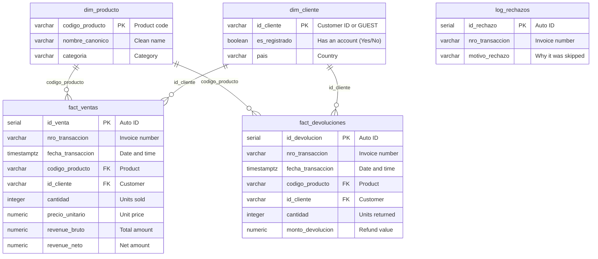

# Data Model Guide - DataMart S.A.S.

A visual guide to how the tables are connected and what each table stores.

---

## Diagram

---

## What Each Table Is For

1. **`dim_producto` (Products):** Central list of products, standardized names, and categories.
2. **`dim_cliente` (Customers):** Distinguishes registered shoppers from guest orders (`GUEST`).
3. **`fact_ventas` (Sales):** Records every completed order with quantities and prices.
4. **`fact_devoluciones` (Returns):** Tracks returned units and refund totals separately from sales.
5. **`log_rechazos` (Audit Log):** Keeps track of bad records (like $0 price) so you can review what went wrong and why.
